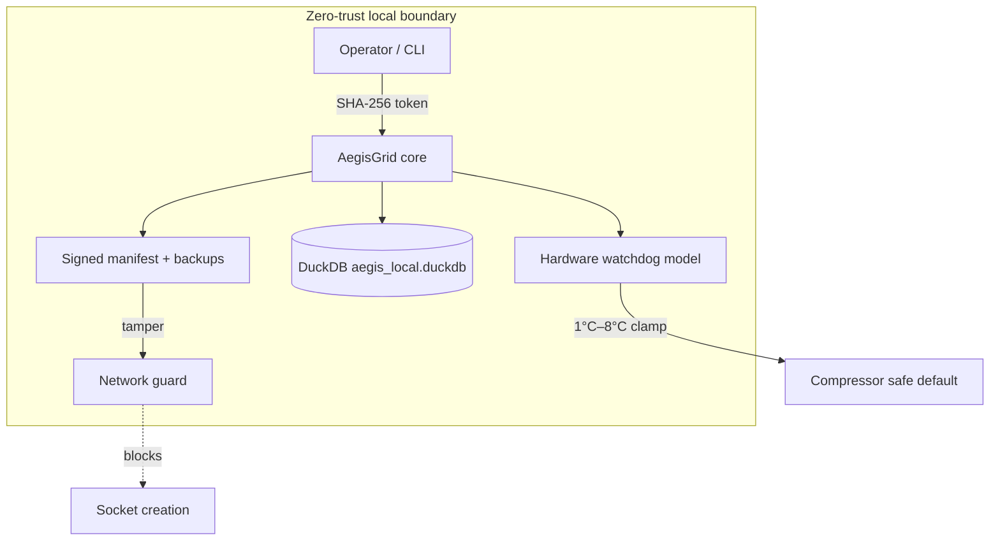

```
     _                _       ____       _     _ 
    / \   ___ ___  __| | __ _|  _ \ __ _(_) __| |
   / _ \ / __/ _ \/ _` |/ _` | |_) / _` | |/ _` |
  / ___ \ (_|  __/ (_| | (_| |  __/ (_| | | (_| |
 /_/   \_\___\___|\__,_|\__, |_|   \__,_|_|\__,_|
                        |___/                    
```

# AegisGrid

**Free, open-source (MIT)** local control and audit patterns for IoT refrigeration gateways — DuckDB storage, operator tokens, temperature safety bounds, and signed file integrity. **No cloud AI. No paid tier. No account required.**

| | |
|---|---|
| **New here?** | Start with **[QUICKSTART.md](QUICKSTART.md)** (~5 min) |
| **Sharing the project?** | See **[LINKEDIN.md](LINKEDIN.md)** (accurate wording + disclaimer links) |
| **Legal** | [LICENSE](LICENSE) · [DISCLAIMER.md](DISCLAIMER.md) |

> **Honest scope:** AegisGrid is a **reference implementation** with automated tests. It **helps** with local access control, auditing, and tamper response modelling; it does **not** guarantee that attackers cannot compromise your systems, and it is **not** a substitute for certified hardware safety or professional engineering sign-off.

---

## Features

| Capability | Description |
|------------|-------------|
| **CLI (`aegisgrid`)** | `init`, `status`, `temperature set`, `threat`, `integrity check`, `manifest sign` |
| **Local DuckDB engine** | Threat cache, hardware state ledger, and audit log in `aegis_local.duckdb` |
| **Temperature safety** | Hard limits **1°C – 8°C** with watchdog override of compressor state |
| **Access control** | SHA-256 hashed tokens; unauthorized commands are rejected and audited |
| **Integrity & lockdown** | HMAC-signed manifest verification, rollback from `.aegis_backup/`, socket lockdown on tamper |
| **Offline-first** | No network required for normal operation |

---

## Requirements

- Python **3.11+**
- Linux or embedded Linux (developed on generic Linux)

---

## Installation

```bash
git clone https://github.com/tgollogly/AegisGrid.git
cd AegisGrid
python3 -m venv .venv && source .venv/bin/activate
pip install -r requirements.txt
pip install -e .    # installs `aegisgrid` on your PATH
```

Optional production secret for manifest signing:

```bash
export AEGIS_MANIFEST_HMAC_KEY="$(openssl rand -hex 32)"
```

---

## Quick start (CLI)

```bash
aegisgrid init
aegisgrid status
aegisgrid temperature set --value 4.0
aegisgrid threat add --indicator 203.0.113.1 --type blocked_ip --severity 7
aegisgrid threat list
```

Try the guided demo:

```bash
bash examples/first_run.sh
```

Full walkthrough: **[QUICKSTART.md](QUICKSTART.md)**

### Quick start (Python API)

```python
from core import AegisGrid

with AegisGrid(root_dir=".") as grid:
    token = grid.generate_token()
    grid.register_operator_token(token)
    print(grid.set_temperature(token, requested_c=4.0))
```

---

## CLI reference

| Command | Purpose |
|---------|---------|
| `aegisgrid init` | Create DB + operator token (`.aegis_operator_token`) |
| `aegisgrid status` | Lockdown flag + latest temperature/compressor state |
| `aegisgrid token create` | Add another authorized token (prints once) |
| `aegisgrid temperature set --value °C` | Authorized set (watchdog enforces 1–8°C) |
| `aegisgrid threat add` / `list` | Local DuckDB threat cache |
| `aegisgrid manifest sign <files...>` | Build signed `aegis_manifest.json` |
| `aegisgrid integrity check` | Verify hashes; rollback + lockdown on tamper |

Global option: `--root /path/to/appliance` (default: current directory).

```bash
aegisgrid --help
```

---

## Architecture overview

AegisGrid uses a **local trust boundary**: the gateway hosts policy and data. When integrity verification fails, networking ** fails closed** (new sockets blocked).



**DuckDB tables:** `access_control`, `threat_cache`, `hardware_state`, `system_audit`

---

## Security hardening checklist

- Set `AEGIS_MANIFEST_HMAC_KEY` in production (not the dev default).
- Protect `.aegis_operator_token`; rotate with `aegisgrid token create`.
- Run as a dedicated OS user with minimal permissions.
- Schedule `aegisgrid integrity check` after updates (cron/systemd).
- Keep physical thermal hardware interlocks on real appliances.

---

## Testing

```bash
python3 -m pytest -q
```

---

## Troubleshooting

| Symptom | Action |
|---------|--------|
| `AccessDeniedError` | Run `aegisgrid init` or pass a valid `--token` |
| Watchdog override in logs | Temperature was outside 1°C–8°C |
| `NetworkLockdownError` | Tamper detected — fix files/manifest/HMAC key |
| DuckDB locked | Only one process should open the DB |

```bash
duckdb aegis_local.duckdb "SELECT * FROM system_audit ORDER BY id DESC LIMIT 20;"
```

---

## FAQ

**Is it really free?**  
Yes. [MIT License](LICENSE) — use, modify, and share at no cost.

**Does it stop hackers?**  
No software can promise that. AegisGrid adds **local** controls and tamper response patterns; you still must harden the OS, network, and physical access.

**Does it need internet or AI?**  
No.

**Is it safety-certified?**  
No. See [DISCLAIMER.md](DISCLAIMER.md).

---

## License

Copyright (c) 2026 [tgollogly](https://github.com/tgollogly).

AegisGrid is released under the **[MIT License](LICENSE)** — free to use, modify, and distribute with attribution and licence text.

**Important:** The [Legal disclaimer](DISCLAIMER.md) applies to safety-critical and security-sensitive deployments. The MIT License does not replace your obligation to validate hardware interlocks, regulatory compliance, and operational procedures on target equipment.
