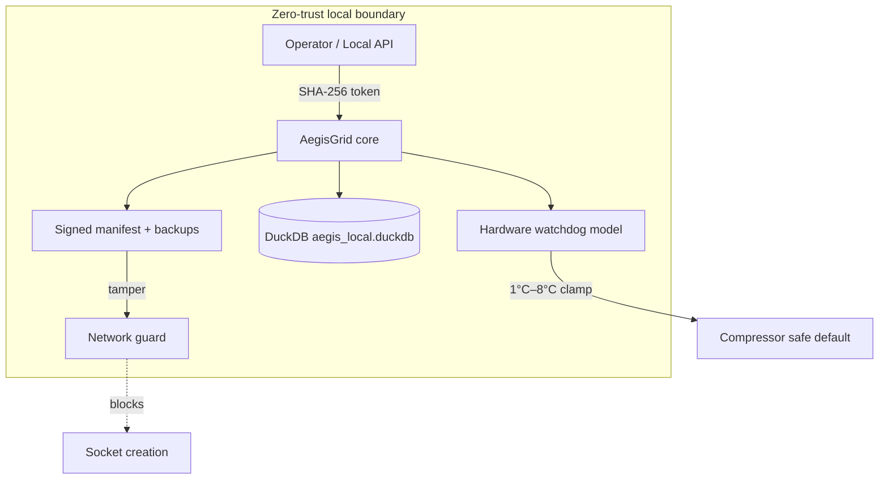

```
     _                _       ____       _     _ 
    / \   ___ ___  __| | __ _|  _ \ __ _(_) __| |
   / _ \ / __/ _ \/ _` |/ _` | |_) / _` | |/ _` |
  / ___ \ (_|  __/ (_| | (_| |  __/ (_| | | (_| |
 /_/   \_\___\___|\__,_|\__, |_|   \__,_|_|\__,_|
                        |___/                    
```

# AegisGrid

**AegisGrid** is a production-oriented, fully local control plane for IoT refrigeration appliances. It combines DuckDB-backed threat intelligence, cryptographic access control, hardware-style temperature watchdog logic, and signed manifest integrity checking—without any external AI or cloud inference dependencies at runtime.

---

## Features

| Capability | Description |
|------------|-------------|
| **Local DuckDB engine** | Threat cache, hardware state ledger, and audit log in `aegis_local.duckdb` |
| **Temperature safety** | Hard limits **1°C – 8°C** with watchdog override of compressor state |
| **Access control** | SHA-256 hashed tokens; unauthorized commands are rejected and audited |
| **Integrity & lockdown** | HMAC-signed manifest verification, automatic rollback, network socket lockdown on tamper |
| **Offline-first** | No network required for normal operation; lockdown blocks sockets when policy demands |

---

## Requirements

- Python **3.11+**
- Linux or embedded Linux target (developed and tested on generic Linux)

---

## Installation

1. **Clone or copy** this repository to your appliance gateway or development machine.

2. **Create a virtual environment** (recommended):

   ```bash
   python3 -m venv .venv
   source .venv/bin/activate
   ```

3. **Install dependencies**:

   ```bash
   pip install -r requirements.txt
   ```

   For development (includes pytest):

   ```bash
   pip install -e ".[dev]"
   ```

4. **Optional — manifest HMAC key** (production):

   ```bash
   export AEGIS_MANIFEST_HMAC_KEY="$(openssl rand -hex 32)"
   ```

   The default development key is embedded only for local testing; change it before deployment.

---

## Quick start

```python
from core import AegisGrid

grid = AegisGrid(root_dir=".")
token = grid.generate_token()
grid.register_operator_token(token)

result = grid.set_temperature(token, requested_c=4.0)
print(result.applied_c, result.watchdog_override)

threats = grid.query_threats(min_severity=5)
grid.close()
```

Run the module entrypoint:

```bash
python core.py
```

---

## Architecture overview

AegisGrid assumes a **zero-trust local boundary**: the appliance gateway is the trust anchor. External networks are not required for control decisions; when integrity fails, the system ** fails closed** on networking.



**Data stores (DuckDB tables)**

- `access_control` — authorized token hashes and roles  
- `threat_cache` — local threat indicators (IPs, hashes, etc.)  
- `hardware_state` — temperature and compressor ledger with watchdog flags  
- `system_audit` — authentication, manifest, and watchdog events  

**Integrity pipeline**

1. Load `aegis_manifest.json` and verify HMAC signature.  
2. Compare SHA-256 of each listed file to the manifest.  
3. On mismatch: restore from `.aegis_backup/`, write audit records, engage **network lockdown**.  

---

## Security hardening checklist

- Replace default manifest HMAC key via `AEGIS_MANIFEST_HMAC_KEY`.  
- Provision unique operator tokens with `register_operator_token`; store plaintext tokens only in a secure vault.  
- Run the gateway as a dedicated system user with minimal filesystem permissions.  
- Schedule `run_integrity_check()` from systemd or cron after updates.  
- Keep `.aegis_backup/` read-only to the service account after snapshots.  

---

## Testing

```bash
pytest -q
```

Tests cover authentication, injection-style temperature attacks, DuckDB threat queries, manifest tamper rollback, and network lockdown behavior.

---

## Troubleshooting & logs

Enable structured logging:

```python
from core import configure_logging
import logging

configure_logging(logging.DEBUG)
```

| Symptom | Likely cause | Action |
|---------|----------------|--------|
| `AccessDeniedError` | Invalid or unregistered token | Register token or rotate credentials in `access_control` |
| `watchdog_override` in audit log | Temperature outside 1°C–8°C | Inspect sensor calibration and physical door seals |
| `NetworkLockdownError` | Manifest tamper or failed rollback | Verify `aegis_manifest.json`, restore from `.aegis_backup/`, fix HMAC key mismatch |
| DuckDB locked errors | Multiple processes opening DB | Single-instance lock via systemd `ExecStart` |

Audit rows are stored in `system_audit`; hardware history in `hardware_state`. Query with DuckDB CLI:

```bash
duckdb aegis_local.duckdb "SELECT * FROM system_audit ORDER BY id DESC LIMIT 20;"
```

---

## FAQ

**Does AegisGrid require internet or AI services?**  
No. All logic, threat storage, and verification run locally. Optional network use is application-defined; AegisGrid can block socket creation when lockdown is active.

**What happens if software tries to set −10°C or 25°C?**  
The watchdog model clamps the recorded temperature to **1°C** or **8°C** respectively and forces the compressor to the configured safe default (`WATCHDOG_SAFE_COMPRESSOR_ON`), regardless of whether the command was authorized or injected.

**Can I update application files safely?**  
Yes. Update files, regenerate SHA-256 entries, sign the manifest payload with your HMAC key, deploy `aegis_manifest.json`, and call `run_integrity_check()`. Snapshots in `.aegis_backup/` enable rollback if verification fails.

**Where is the database file?**  
By default, `aegis_local.duckdb` in the `root_dir` passed to `AegisGrid` (current working directory if omitted).

**Is this a substitute for physical safety hardware?**  
AegisGrid includes a **software model** of a watchdog circuit suitable for integration testing and gateway policy. Production appliances should still use certified thermal switches and independent hardware interlocks as required by your safety standards.

---

## License

Copyright (c) 2026 [tgollogly](https://github.com/tgollogly).

AegisGrid is released under the **[MIT License](LICENSE)**. You may use, modify, and distribute the software subject to that license.

**Important:** The [Legal disclaimer](DISCLAIMER.md) applies to safety-critical and security-sensitive deployments. The MIT License does not replace your obligation to validate hardware interlocks, regulatory compliance, and operational procedures on target equipment.
